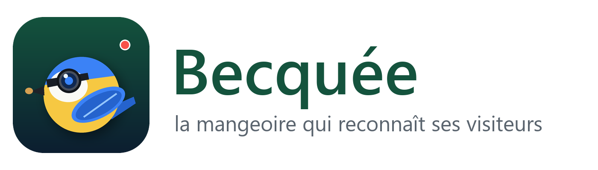
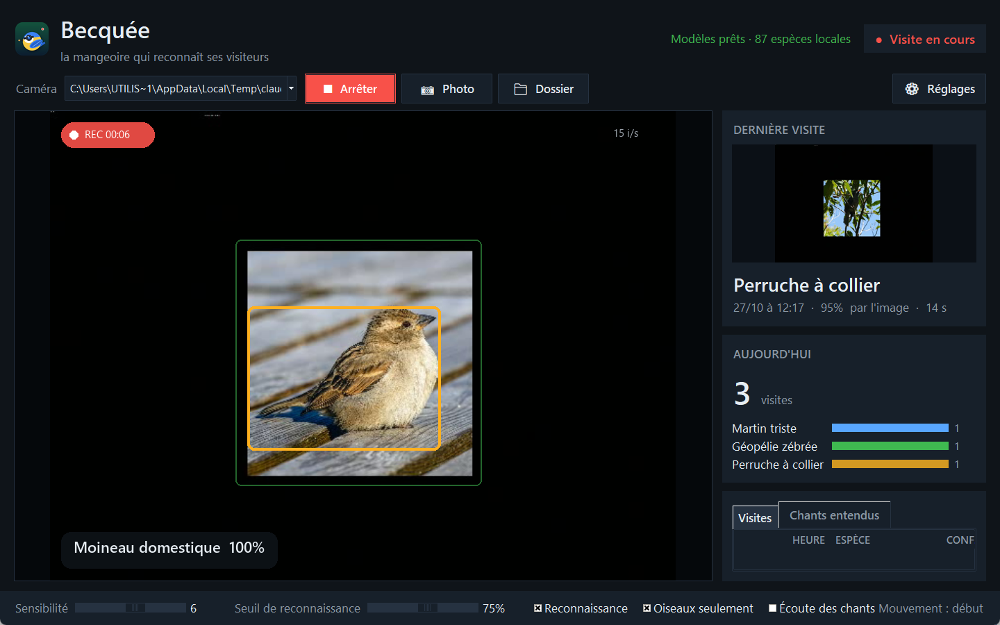
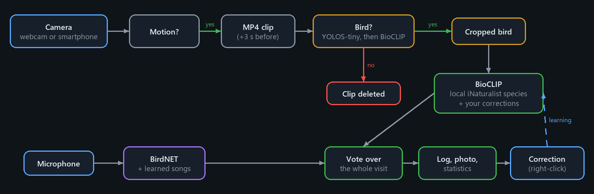
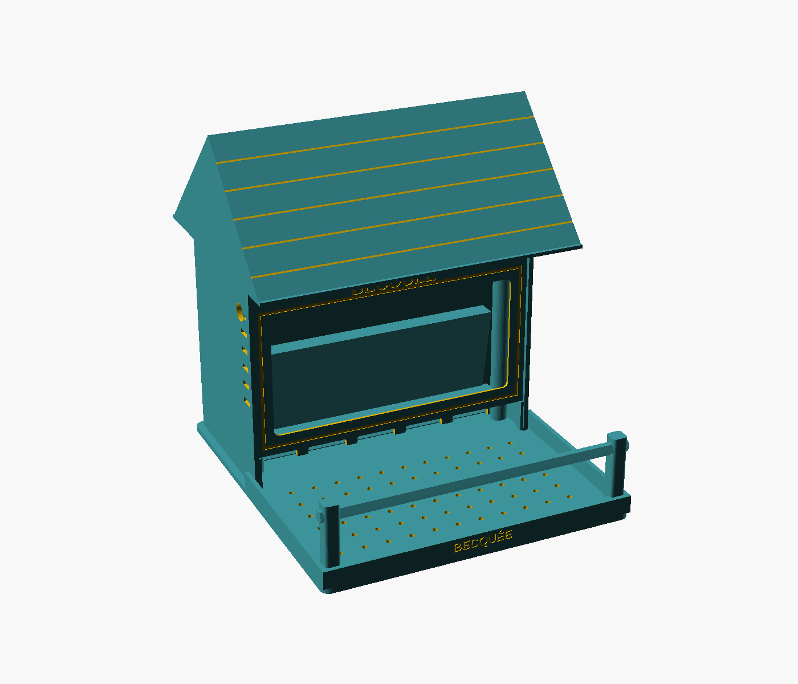
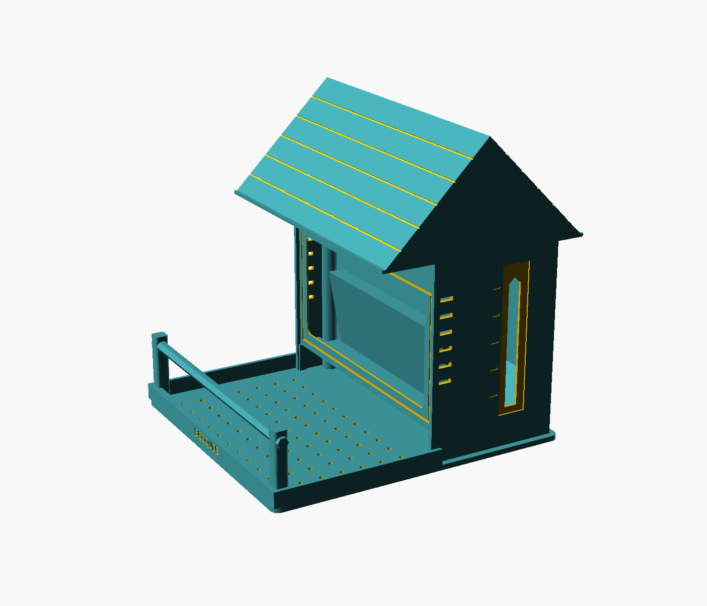
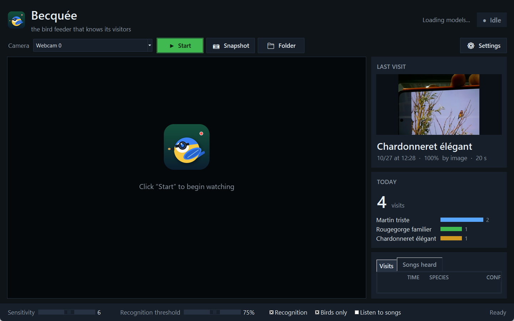

<p align="center"></p>

<p align="center"><b>The bird feeder that knows its visitors</b><br>
A 3D-printed camera bird feeder + a Windows app that records, recognizes and learns birds — anywhere in the world.</p>

<p align="center">
<a href="README.md">🇫🇷 Français</a> · 🇬🇧 English
</p>

<p align="center"></p>

> *Becquée* (French) means a beakful — the bit of food a bird takes in its beak.

---

## Contents

1. [Features](#features)
2. [How it works](#how-it-works)
3. [The feeder (3D printing)](#the-feeder-3d-printing)
4. [Installing the app](#installing-the-app)
5. [Using it](#using-it)
6. [Languages](#languages)
7. [Output files](#output-files)
8. [Command line](#command-line)
9. [Development](#development)
10. [Models, data and licenses](#models-data-and-licenses)
11. [Known limitations](#known-limitations)

---

## Features

| | |
|---|---|
| 🎥 **Automatic recording** | Motion in front of the camera starts an MP4 clip, including the 3 seconds before the bird arrived. |
| 🐦 **Birds only** | Every motion is checked by a bird detector; wind, leaves, cats or passers-by leave no clip. |
| 🔎 **Species recognition, worldwide** | BioCLIP identifies the bird among the species actually observed around the feeder (iNaturalist list). |
| 🎵 **Birdsong recognition** | BirdNET listens to the microphone (~6,000 species); songs confirm or complete the image. |
| 🧠 **Learning** | Right-click to correct a visit: Becquée learns from the photo at once, even for a species missing from the list. |
| 🏝️ **Endemic species** | Songs of local species unknown to BirdNET can be learned (iNaturalist, xeno-canto, sounds from your own visits). |
| 🌍 **6 languages** | Français, English, Español, Deutsch, Português, Italiano — interface **and** species names. |
| 🧹 **Automatic cleanup** | Old clips deleted, folder size capped; the visit log is kept. |
| 📦 **Complete installer** | One offline file: Python, libraries and models included, no admin rights needed. |

---

## How it works

<p align="center"></p>

- **Local list**: from the feeder's location, Becquée downloads the species observed (iNaturalist research-grade observations) within 50 km, widened to 200 then 1,000 km in poorly surveyed regions. It is cached for 30 days; offline, BirdNET's geographic model takes over.
- **Image**: BioCLIP compares the cropped bird with the scientific (and English) name of each local species. With equal evidence, a species common in the region wins over a rarity. The chosen species must come first in at least half of the visit's analyses and reach the set threshold; otherwise the visit is logged as "Unknown".
- **Bird or not**: the YOLOS-tiny detector looks for the "bird" class; if it sees nothing, BioCLIP judges the moving area (two confident 85 % opinions are required).
- **Songs**: BirdNET analyzes the microphone in 3-second windows. A confident song heard during an "Unknown" visit names the species; if it agrees with the image, the visit is logged as "image + song".
- **Learning**: every corrected photo becomes an example (an image memory in the spirit of *Tip-Adapter*); a single photo is often enough. "Not a bird" is learned the same way.

---

## The feeder (3D printing)

<p align="center">
  
</p>

Parametric source: [`modele_3d/becquee.scad`](modele_3d/becquee.scad) (OpenSCAD 2021.01). Ready-to-print STLs in [`modele_3d/stl/`](modele_3d/stl).
Tested on an Elegoo Centauri Carbon 2; any 235 × 235 mm bed works (largest part: 232 mm).

| File | Qty | Orientation |
|---|---|---|
| `becquee_socle.stl` (base) | 1 | flat |
| `becquee_corps.stl` (body) | 1 | upright |
| `becquee_facade.stl` (front) | 1 | flat, front face down |
| `becquee_toit.stl` (roof) | 1 | upright (45° slopes) |
| `becquee_perchoir.stl` (perch) | 1 | lying (or an 8 mm wooden dowel) |
| `becquee_cale.stl` (wedge) | 1 | flat — tilts the device 10° toward the perch |
| `becquee_support_poteau.stl` (pole mount) | optional | plate on the bed — for a 25 mm pole |

**Settings**: PETG or ASA (ASA in full sun), 0.2 mm layers, 4 walls, no supports.

**Hardware**
- 8 neodymium magnets Ø 6 × 3 mm (4 on top of the body columns, 4 under the roof — check polarity!)
- 4 self-tapping screws Ø 3 × 12 (base → body, from below)
- 2 mm acrylic sheet, 178 × 88 mm, glued behind the front window
- 1 mm clear strip, 20 × 110 mm, glued over the seed-level window
- pole option: 4 screws Ø 3 × 12 + 1 M4 × 12 locking screw

**Assembly**: screw the body onto the base → glue the magnets → slide the front in from the top → place the wedge against the hopper, then the device (lens against the window) → route the USB cable through the hole in the right side → put the roof on (it snaps onto the magnets). Fill the hopper with the roof off; the seed level shows in the graduated window on the left side. Wall-mount through the keyhole slots at the back, or use the pole mount.

**Generating STLs** (after changing parameters):

```bash
openscad -o becquee_corps.stl -D "piece=\"corps\"" modele_3d/becquee.scad
```

Parts: `socle`, `corps`, `facade`, `toit`, `perchoir`, `cale`, `support_poteau` (or `assemblage` for the assembled view).

---

## Installing the app

### With the installer (recommended)

Windows 10 or 11, 64-bit, ~3 GB of disk space. Run **`Becquee_Installation.exe`** (~850 MB):

- everything is included (Python 3.11, PyTorch, OpenCV, bird and song models): **no Internet connection is needed to install**;
- per-user installation, **no admin rights**;
- language choice, desktop and Start menu shortcuts, optional start with Windows;
- uninstall from *Settings › Apps*: your videos and settings are kept.

The installer is built with [`installateur/construire_installateur.ps1`](installateur/construire_installateur.ps1) (see [Development](#building-the-installer)).

### From source

Python 3.11 (with Tkinter):

```bash
cd logiciel
python -m venv venv
venv\Scripts\pip install torch torchvision --index-url https://download.pytorch.org/whl/cpu
venv\Scripts\pip install -r requirements.txt
venv\Scripts\pythonw mangeoire_app.py
```

On first launch, the models (~800 MB) are downloaded from Hugging Face and GitHub.

---

## Using it

<p align="center"></p>

1. **First launch**: the *Settings* window opens. Type your town in *Feeder location*, click **Search**, then **Save**. Becquée downloads the list of birds in your area.
2. **Camera**:
   - **USB webcam**: place it lens against the window, pick "Webcam 0";
   - **Android smartphone**: *IP Webcam* app → "Start server", then type the address it shows into the Camera field, e.g. `http://192.168.1.20:8080/video` (keep the phone plugged in);
   - **Camera on the Internet** (live nest or feeder cam): paste the address of the YouTube page (or Twitch…, read by [yt-dlp](https://github.com/yt-dlp/yt-dlp)) or of an `.m3u8` stream, and set the *Position* to the camera's location. The PC microphone is not used for these visits.
3. **Start**: the video appears; green box = motion, amber box = bird detected, "REC" during a visit, species overlaid.
4. **Correct**: right-click a visit → right species, *Other species…* (common or scientific name) or *Not a bird*. Becquée learns at once.

**Quick settings** (bottom bar)

| Setting | Effect |
|---|---|
| Sensitivity | Raise it if birds don't trigger recording, lower it if wind does. |
| Recognition threshold | Minimum confidence to name the species (75 % by default). |
| Recognition | Turn off to record only. |
| Birds only | Deletes motion without a bird. |
| Listen to songs | BirdNET on the microphone; "Microphone silent" is shown if it picks up nothing. |

**Full settings**: language, location, visits folder, auto-start, cleanup (by default: clips older than 60 days deleted, folder capped at 20 GB), microphone, song threshold, xeno-canto key.

**Learn missing songs**: BirdNET does not know every species (many endemics are missing). This button gathers recordings of those species — iNaturalist, xeno-canto if you have a [free API key](https://xeno-canto.org/explore/api), and sounds kept automatically when a visit is confidently recognized by image — then trains a small classifier on BirdNET's sound embeddings. The threshold is calibrated for under 1 % false alarms, and this add-on is only used within 500 km of where it was learned.

---

## Languages

Interface, messages and **species names** in **French, English, Spanish, German, Portuguese (Brazil) and Italian**.

- On first launch, Becquée uses the Windows language (or the one chosen in the installer);
- *Settings › Language* to change it: the app restarts in the new language;
- species names come from iNaturalist in the chosen language, falling back to BirdNET's translated names (BirdNET-Go project), then to English names;
- visits already recorded keep the species name in the language they were logged in.

---

## Output files

In the visits folder (by default `Videos\Becquee`):

| File | Content |
|---|---|
| `YYYY-MM-DD_HH-MM-SS_<Species>.mp4` | visit clip |
| `…_<Species>.jpg` / `…_<Species>_oiseau.jpg` | best frame / cropped bird |
| `visites.csv` | date, time, duration, species, confidence, source (image, song, image+song, manual), songs heard, correction |
| `chants.csv` | recognized songs (at most one line per species per minute) |
| `corrections\<species>\` | corrected photos, used as learning examples |
| `chants_perso\<species>\` | sounds kept to learn songs of species missing from BirdNET (you can add your own recordings) |

Settings: `%USERPROFILE%\.becquee.json`.

---

## Command line

```bash
python logiciel/mangeoire_cam.py --source 0 --dossier visits --position 51.5 -0.12 --chants --apercu
python logiciel/mangeoire_cam.py --source recording.mp4 --dossier output --position 40.71 -74.0
python logiciel/chants_complement.py --position -21.1 55.5 --cle-xeno-canto YOUR_KEY
```

`--source`: webcam index, smartphone stream URL, RTSP stream, live camera page (YouTube…) or video file. `--help` lists every option (sensitivity, threshold, clip length, cleanup…).

---

## Development

```
becquee/
├── logiciel/
│   ├── mangeoire_app.py        Tkinter interface
│   ├── mangeoire_cam.py        engine: camera, detection, recognition, songs, log
│   ├── chants_complement.py    learning songs missing from BirdNET
│   ├── langues.py              translations (6 languages)
│   ├── creer_logo.py           generates the logo and icon
│   ├── requirements.txt
│   └── tests/                  translation check, interface tests, test videos
├── modele_3d/                  OpenSCAD source, STLs, previews
├── installateur/               build script + Inno Setup script
└── docs/                       screenshots, diagram (docs/schema.py redraws it)
```

The code is written in French (names, comments); user-facing text goes through `langues._()`.

**Tests**

```bash
cd logiciel
python tests/verifier_traductions.py                 # every string translated in all 6 languages, same fields
python tests/test_langues.py en <visits> <output>    # opens the interface in English and captures it
```

The videos in [`tests/videos/`](logiciel/tests/videos) simulate a feeder on Réunion Island: 12 species (real photos) landing one after another, plus a fake visitor. Expected result with `--position -21.1 55.5`: all 12 species right and the fake visitor deleted.

**Adding a language**: add its code to `LANGUES`, `LOCALE_INATURALIST` and `ETIQUETTES_BIRDNET` in [`langues.py`](logiciel/langues.py), then a translation in every `TEXTES` entry; `tests/verifier_traductions.py` reports anything missing. For the installer, add the language to [`becquee.iss`](installateur/becquee.iss).

### Building the installer

Requirements: [Inno Setup 6](https://jrsoftware.org/isdl.php) and the models already downloaded (run the app once).

```bash
powershell -ExecutionPolicy Bypass -File installateur/construire_installateur.ps1
```

The script prepares a standalone Python 3.11 ([python-build-standalone](https://github.com/astral-sh/python-build-standalone)), installs CPU PyTorch and the dependencies, adds the app, the BirdNET, BioCLIP and YOLOS models and the 3D files, then compiles `Becquee_Installation.exe`.

---

## Models, data and licenses

| Component | Source | License |
|---|---|---|
| Species recognition | [BioCLIP](https://huggingface.co/imageomics/bioclip) (Imageomics) | MIT |
| Bird detection | [YOLOS-tiny](https://huggingface.co/hustvl/yolos-tiny) | Apache 2.0 |
| Songs | [BirdNET v2.4](https://github.com/kahst/BirdNET-Analyzer) ([ONNX version](https://huggingface.co/justinchuby/BirdNET-onnx)) | **CC BY-NC-SA 4.0 — non-commercial** |
| Translated species names | [BirdNET-Go](https://github.com/tphakala/birdnet-go) | see project |
| Local species, recordings | [iNaturalist](https://www.inaturalist.org) (public API) | per observation |
| Recordings (optional) | [xeno-canto](https://xeno-canto.org) (free API key) | per recording |
| Place search | [OpenStreetMap Nominatim](https://nominatim.openstreetmap.org) | ODbL |

Because of BirdNET, the whole package cannot be used commercially as is. Becquée sends your location (or town name) to iNaturalist and OpenStreetMap for these lookups; no video or photo ever leaves your computer.

---

## Known limitations

- **Windows only** for the interface and installer (the `mangeoire_cam.py` engine is plain Python).
- **Endemic songs**: with few public recordings (1 to 5 per species without a xeno-canto key), the safe 99 % threshold still rarely recognizes these songs; a xeno-canto key and the sounds kept from visits improve this over time.
- **CPU only**: everything runs on the processor (~0.15 s per image analysis); keep a PC running, or dedicate an old laptop.
- **Microphone**: a muted microphone (keyboard key, level 0 in Windows) is reported as "Microphone silent".
