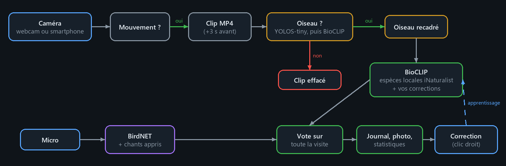
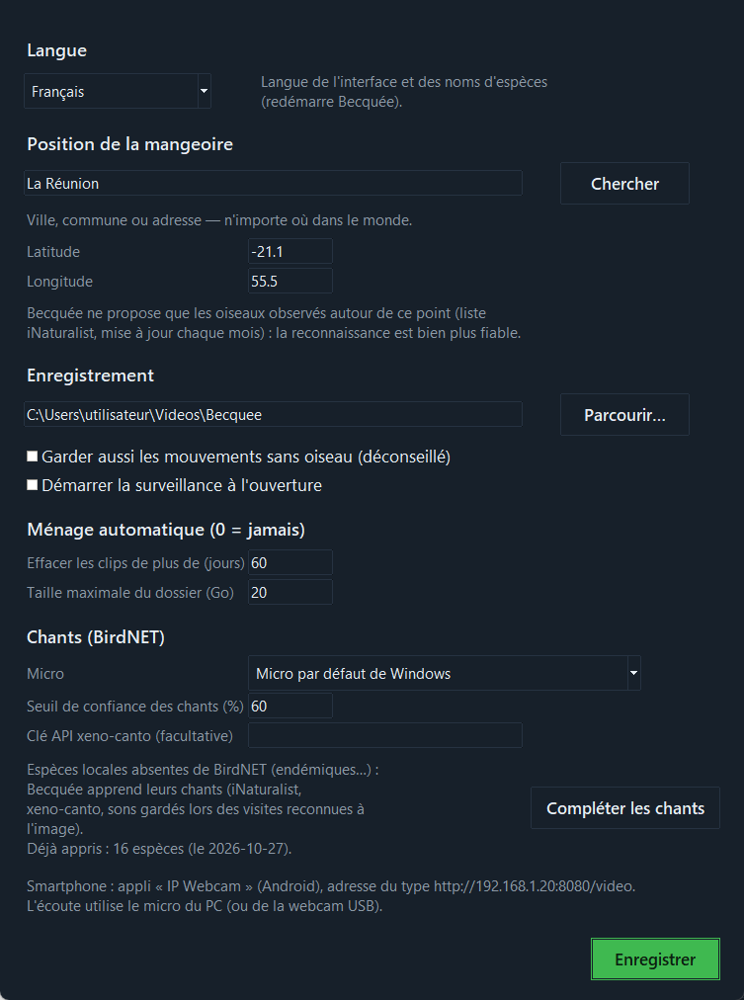
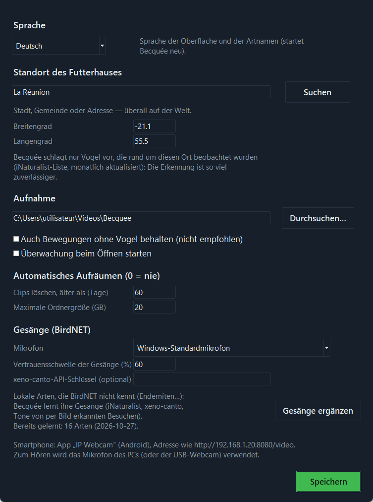

<p align="center"></p>

<p align="center"><b>La mangeoire qui reconnaît ses visiteurs</b><br>
Mangeoire à caméra imprimée en 3D + application Windows qui filme, reconnaît et apprend les oiseaux — partout dans le monde.</p>

<p align="center">
🇫🇷 Français · <a href="README.en.md">🇬🇧 English</a>
</p>

<p align="center"></p>

---

## Sommaire

1. [Fonctionnalités](#fonctionnalités)
2. [Comment ça marche](#comment-ça-marche)
3. [La mangeoire (impression 3D)](#la-mangeoire-impression-3d)
4. [Installer l'application](#installer-lapplication)
5. [Utilisation](#utilisation)
6. [Langues](#langues)
7. [Fichiers produits](#fichiers-produits)
8. [Ligne de commande](#ligne-de-commande)
9. [Développement](#développement)
10. [Modèles, données et licences](#modèles-données-et-licences)
11. [Limites connues](#limites-connues)

---

## Fonctionnalités

| | |
|---|---|
| 🎥 **Enregistrement automatique** | Un mouvement devant la caméra déclenche un clip MP4, avec les 3 secondes qui précèdent l'arrivée de l'oiseau. |
| 🐦 **Oiseaux seulement** | Chaque mouvement est vérifié par un détecteur d'oiseaux ; vent, feuilles, chats ou passants ne laissent aucun clip. |
| 🔎 **Reconnaissance de l'espèce, partout dans le monde** | BioCLIP reconnaît l'oiseau parmi les espèces réellement observées autour de la mangeoire (liste iNaturalist). |
| 🎵 **Reconnaissance des chants** | BirdNET écoute le micro (~6 000 espèces) ; les chants confirment ou complètent l'image. |
| 🧠 **Apprentissage** | Un clic droit pour corriger une visite : Becquée apprend aussitôt de la photo, même pour une espèce absente de la liste. |
| 🏝️ **Espèces endémiques** | Les chants des espèces locales inconnues de BirdNET peuvent être appris (iNaturalist, xeno-canto, sons de vos visites). |
| 🌍 **6 langues** | Français, English, Español, Deutsch, Português, Italiano — interface **et** noms d'espèces. |
| 🧹 **Ménage automatique** | Anciens clips effacés, taille du dossier plafonnée ; le journal des visites est conservé. |
| 📦 **Installateur complet** | Un seul fichier, hors ligne : Python, bibliothèques et modèles inclus, sans droits administrateur. |

---

## Comment ça marche

<p align="center"></p>

- **Liste locale** : à partir de la position de la mangeoire, Becquée télécharge les espèces observées (observations validées iNaturalist) dans un rayon de 50 km, élargi à 200 puis 1 000 km dans les régions peu observées. Elle est mise en cache 30 jours ; sans réseau, le méta-modèle géographique de BirdNET prend le relais.
- **Image** : BioCLIP compare l'oiseau recadré au nom scientifique (et anglais) de chaque espèce locale. Une espèce fréquente dans la région l'emporte, à image égale, sur une rareté. L'espèce retenue doit arriver en tête sur au moins la moitié des analyses de la visite et atteindre le seuil réglé ; sinon la visite est notée « Inconnu ».
- **Oiseau ou pas** : le détecteur YOLOS-tiny cherche la classe « bird » ; s'il ne voit rien, BioCLIP juge la zone en mouvement (deux avis sûrs à 85 % sont nécessaires).
- **Chants** : BirdNET analyse le micro par fenêtres de 3 s. Un chant sûr entendu pendant une visite « Inconnu » donne l'espèce ; s'il confirme l'image, la visite est notée « image + chant ».
- **Apprentissage** : chaque photo corrigée devient un exemple (mémoire d'images à la manière de *Tip-Adapter*) ; une seule photo suffit souvent. « Pas un oiseau » s'apprend de la même façon.

---

## La mangeoire (impression 3D)

<p align="center">
  
</p>

Source paramétrique : [`modele_3d/becquee.scad`](modele_3d/becquee.scad) (OpenSCAD 2021.01). STL prêts à imprimer dans [`modele_3d/stl/`](modele_3d/stl).
Testée sur Elegoo Centauri Carbon 2 ; tout plateau de 235 × 235 mm convient (plus grande pièce : 232 mm).

| Fichier | Qté | Orientation |
|---|---|---|
| `becquee_socle.stl` | 1 | à plat |
| `becquee_corps.stl` | 1 | debout |
| `becquee_facade.stl` | 1 | à plat, face avant sur le plateau |
| `becquee_toit.stl` | 1 | debout (pentes à 45°) |
| `becquee_perchoir.stl` | 1 | couché (ou tourillon bois Ø 8 mm) |
| `becquee_cale.stl` | 1 | à plat — incline l'appareil de 10° vers le perchoir |
| `becquee_support_poteau.stl` | option | plaque sur le plateau — pour poteau Ø 25 mm |

**Réglages** : PETG ou ASA (ASA en plein soleil), couches de 0,2 mm, 4 périmètres, sans supports.

**Quincaillerie**
- 8 aimants néodyme Ø 6 × 3 mm (4 en haut des colonnes du corps, 4 sous le toit — vérifier la polarité !)
- 4 vis à tôle Ø 3 × 12 (socle → corps, par dessous)
- plexiglas 2 mm, 178 × 88 mm, collé derrière la fenêtre de la façade
- bande transparente 1 mm, 20 × 110 mm, collée sur la fenêtre de niveau des graines
- option poteau : 4 vis Ø 3 × 12 + 1 vis M4 × 12 de blocage

**Montage** : visser le corps sur le socle → coller les aimants → glisser la façade par le haut → poser la cale contre la trémie, puis l'appareil (objectif contre la vitre) → passer le câble USB par le trou du flanc droit → poser le toit (il se clipse sur les aimants). La trémie se remplit toit retiré ; le niveau se lit sur la fenêtre graduée du flanc gauche. Fixation au mur par les trous de serrure au dos, ou sur poteau avec le support.

**Générer les STL** (après modification des paramètres) :

```bash
openscad -o becquee_corps.stl -D "piece=\"corps\"" modele_3d/becquee.scad
```

Pièces : `socle`, `corps`, `facade`, `toit`, `perchoir`, `cale`, `support_poteau`.

---

## Installer l'application

### Avec l'installateur (recommandé)

Windows 10 ou 11, 64 bits, ~3 Go d'espace disque. Lancer **`Becquee_Installation.exe`** (~850 Mo) :

- tout est inclus (Python 3.11, PyTorch, OpenCV, modèles d'oiseaux et de chants) : **aucune connexion n'est nécessaire pour installer** ;
- installation pour l'utilisateur courant, **sans droits administrateur** ;
- choix de la langue, raccourcis Bureau et menu Démarrer, lancement avec Windows en option ;
- désinstallation par *Paramètres › Applications* : vos vidéos et réglages sont conservés.

L'installateur se construit avec [`installateur/construire_installateur.ps1`](installateur/construire_installateur.ps1) (voir [Développement](#construire-linstallateur)).

### Depuis les sources

Python 3.11 (avec Tkinter) :

```bash
cd logiciel
python -m venv venv
venv\Scripts\pip install torch torchvision --index-url https://download.pytorch.org/whl/cpu
venv\Scripts\pip install -r requirements.txt
venv\Scripts\pythonw mangeoire_app.py
```

Au premier lancement, les modèles (~800 Mo) sont téléchargés depuis Hugging Face et GitHub.

**Carte graphique NVIDIA** : installer PyTorch avec CUDA à la place (`--index-url https://download.pytorch.org/whl/cu126`, ~2,5 Go). Becquée l'utilise d'elle-même (« GPU » s'affiche en haut de la fenêtre) : environ 10 fois plus rapide par image (RTX 3090 : 0,03 s contre 0,27 s).

---

## Utilisation

<p align="center"></p>

1. **Premier lancement** : la fenêtre *Réglages* s'ouvre. Tapez votre ville dans *Position de la mangeoire* et cliquez sur **Chercher**, puis **Enregistrer**. Becquée télécharge la liste des oiseaux de votre région.
2. **Caméra** :
   - **Webcam USB** : la poser objectif contre la vitre, choisir « Webcam 0 » ;
   - **Smartphone Android** : appli *IP Webcam* → « Démarrer le serveur », puis saisir l'adresse affichée dans le champ Caméra, par ex. `http://192.168.1.20:8080/video` (téléphone sur secteur) ;
   - **Caméra sur Internet** (nid, mangeoire filmés en direct) : coller l'adresse de la page YouTube (ou Twitch…, lue par [yt-dlp](https://github.com/yt-dlp/yt-dlp)) ou d'un flux `.m3u8`, et régler la *Position* sur le lieu de la caméra. Le micro du PC n'est pas utilisé pour ces visites.
3. **Démarrer** : la vidéo s'affiche ; cadre vert = mouvement, cadre ambré = oiseau détecté, « REC » pendant une visite, espèce en surimpression.
4. **Corriger** : clic droit sur une visite → bonne espèce, *Autre espèce…* (nom commun ou scientifique) ou *Pas un oiseau*. Becquée apprend aussitôt.

**Réglages rapides** (bas de la fenêtre)

| Réglage | Effet |
|---|---|
| Sensibilité | Monter si les oiseaux ne déclenchent pas, baisser si le vent déclenche. |
| Seuil de reconnaissance | Confiance minimale pour nommer l'espèce (75 % par défaut). |
| Reconnaissance | Désactiver pour seulement enregistrer. |
| Oiseaux seulement | Efface les mouvements sans oiseau. |
| Écoute des chants | BirdNET sur le micro ; « Micro muet » s'affiche si le micro ne capte rien. |

<p align="center"></p>

**Réglages complets** : langue, position, dossier des visites, démarrage automatique, ménage (par défaut : clips de plus de 60 jours effacés, dossier limité à 20 Go), micro, seuil des chants, clé xeno-canto.

**Compléter les chants** : BirdNET ne connaît pas toutes les espèces (beaucoup d'endémiques manquent). Ce bouton rassemble des enregistrements de ces espèces — iNaturalist, xeno-canto si vous avez une [clé API gratuite](https://xeno-canto.org/explore/api), et les sons gardés automatiquement lorsqu'une visite est reconnue avec certitude à l'image — puis entraîne un petit classifieur sur les empreintes sonores BirdNET. Le seuil est calibré pour moins de 1 % de fausses alertes, et ce complément ne sert qu'à moins de 500 km de l'endroit où il a été appris.

---

## Langues

Interface, messages et **noms d'espèces** en **français, anglais, espagnol, allemand, portugais (Brésil) et italien**.

- Au premier lancement, Becquée prend la langue de Windows (ou celle choisie dans l'installateur) ;
- *Réglages › Langue* pour en changer : l'application redémarre dans la nouvelle langue ;
- les noms d'espèces viennent d'iNaturalist dans la langue choisie, à défaut des noms BirdNET traduits (projet BirdNET-Go), puis des noms anglais ;
- les visites déjà enregistrées gardent le nom de l'espèce dans la langue où elles ont été notées.

<p align="center"></p>

---

## Fichiers produits

Dans le dossier des visites (par défaut `Vidéos\Becquee`) :

| Fichier | Contenu |
|---|---|
| `AAAA-MM-JJ_HH-MM-SS_<Espece>.mp4` | clip de la visite |
| `…_<Espece>.jpg` / `…_<Espece>_oiseau.jpg` | meilleure image / oiseau recadré |
| `visites.csv` | date, heure, durée, espèce, confiance, source (image, chant, image+chant, manuel), chants entendus, correction |
| `chants.csv` | chants reconnus (une ligne par espèce et par minute au plus) |
| `corrections\<espèce>\` | photos corrigées, exemples d'apprentissage |
| `chants_perso\<espèce>\` | sons gardés pour apprendre les chants d'espèces absentes de BirdNET (vous pouvez y ajouter vos propres enregistrements) |

Réglages : `%USERPROFILE%\.becquee.json`.

---

## Ligne de commande

```bash
python logiciel/mangeoire_cam.py --source 0 --dossier visites --position -21.1 55.5 --chants --apercu
python logiciel/mangeoire_cam.py --source enregistrement.mp4 --dossier sortie --position 48.85 2.35
python logiciel/chants_complement.py --position -21.1 55.5 --cle-xeno-canto VOTRE_CLE
```

`--source` : index de webcam, URL du flux du smartphone, flux RTSP, page d'une caméra en direct (YouTube…) ou fichier vidéo. `--help` pour toutes les options (sensibilité, seuil, durée des clips, ménage…).

---

## Développement

```
becquee/
├── logiciel/
│   ├── mangeoire_app.py        interface Tkinter
│   ├── mangeoire_cam.py        moteur : caméra, détection, reconnaissance, chants, journal
│   ├── chants_complement.py    apprentissage des chants absents de BirdNET
│   ├── langues.py              traductions (6 langues)
│   ├── creer_logo.py           génère le logo et l'icône
│   ├── requirements.txt
│   └── tests/                  vérification des traductions, tests d'interface, vidéos de test
├── modele_3d/                  source OpenSCAD, STL, aperçus
├── installateur/               script de construction + script Inno Setup
└── docs/                       captures d'écran, schéma (docs/schema.py le redessine)
```

**Tests**

```bash
cd logiciel
python tests/verifier_traductions.py            # chaque texte traduit dans les 6 langues, mêmes champs
python tests/test_moteur.py                     # vidéo de test : 12 espèces justes, faux visiteur effacé (~30 s)
python tests/test_langues.py en <visites> <sortie>   # ouvre l'interface en anglais et la capture
```

Les vidéos [`tests/videos/`](logiciel/tests/videos) simulent une mangeoire de La Réunion : 12 espèces (photos réelles) qui viennent se poser, plus un faux visiteur. Résultat attendu avec `--position -21.1 55.5` : 12 espèces justes et le faux visiteur effacé.

**Ajouter une langue** : ajouter son code dans `LANGUES`, `LOCALE_INATURALIST` et `ETIQUETTES_BIRDNET` de [`langues.py`](logiciel/langues.py), puis une traduction dans chaque entrée de `TEXTES` ; `tests/verifier_traductions.py` signale tout oubli. Côté installateur, ajouter la langue dans [`becquee.iss`](installateur/becquee.iss).

### Construire l'installateur

Prérequis : [Inno Setup 6](https://jrsoftware.org/isdl.php) et les modèles déjà téléchargés (lancer l'application une fois).

```bash
powershell -ExecutionPolicy Bypass -File installateur/construire_installateur.ps1
```

Le script prépare un Python 3.11 autonome ([python-build-standalone](https://github.com/astral-sh/python-build-standalone)), installe PyTorch CPU et les dépendances, ajoute l'application, les modèles BirdNET, BioCLIP et YOLOS, et les fichiers 3D, puis compile `Becquee_Installation.exe`.

---

## Modèles, données et licences

| Élément | Source | Licence |
|---|---|---|
| Reconnaissance des espèces | [BioCLIP](https://huggingface.co/imageomics/bioclip) (Imageomics) | MIT |
| Détection d'oiseaux | [YOLOS-tiny](https://huggingface.co/hustvl/yolos-tiny) | Apache 2.0 |
| Chants | [BirdNET v2.4](https://github.com/kahst/BirdNET-Analyzer) ([version ONNX](https://huggingface.co/justinchuby/BirdNET-onnx)) | **CC BY-NC-SA 4.0 — usage non commercial** |
| Noms d'espèces traduits | [BirdNET-Go](https://github.com/tphakala/birdnet-go) | voir le projet |
| Espèces locales, enregistrements | [iNaturalist](https://www.inaturalist.org) (API publique) | selon chaque observation |
| Enregistrements (facultatif) | [xeno-canto](https://xeno-canto.org) (clé API gratuite) | selon chaque enregistrement |
| Recherche de ville | [OpenStreetMap Nominatim](https://nominatim.openstreetmap.org) | ODbL |

À cause de BirdNET, l'ensemble ne peut pas être utilisé commercialement tel quel. Becquée envoie votre position (ou le nom de votre ville) à iNaturalist et à OpenStreetMap pour ces recherches ; aucune vidéo ni photo ne quitte votre ordinateur.

---

## Limites connues

- **Windows uniquement** pour l'interface et l'installateur (le moteur `mangeoire_cam.py` est en Python standard).
- **Chants des endémiques** : avec peu d'enregistrements publics (1 à 5 par espèce sans clé xeno-canto), le seuil sûr de 99 % reconnaît encore rarement ces chants ; la clé xeno-canto et les sons gardés lors des visites améliorent la situation avec le temps.
- **Processeur** : l'installateur tourne sur le CPU (~0,15 s par analyse d'image) ; prévoir un PC allumé, ou un vieux portable dédié. Une carte NVIDIA n'est utilisée qu'avec l'installation depuis les sources (voir plus haut).
- **Micro** : un micro coupé (touche du clavier, niveau 0 dans Windows) est signalé par « Micro muet ».
